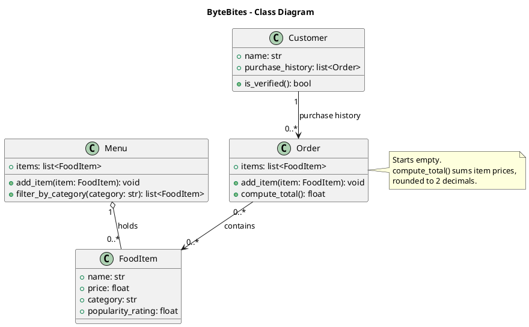

# ByteBites Design

## Class Diagram

## Classes
- **Customer**: a user of the app, identified by name, whose purchase history is used to verify they are real.
- **FoodItem**: a single item for sale, with a name, price, category, and popularity rating.
- **Menu**: the full collection of food items, filterable by category.
- **Order**: a single transaction grouping the selected items and computing their total cost.

## Traceability to the Feature Request
| Requirement | Design element |
|---|---|
| Track customer names and past purchase history | `Customer.name`, `Customer.purchase_history` |
| Verify customers are real users | `Customer.is_verified()` |
| Track name, price, category, popularity for every item | `FoodItem` attributes |
| A list that holds all items | `Menu.items` |
| Filter by category (e.g., "Drinks", "Desserts") | `Menu.filter_by_category()` |
| Group selected items into a single transaction | `Order.items`, `Order.add_item()` |
| Compute the total cost | `Order.compute_total()` |

## Assumptions
- `is_verified()` returns `True` if the customer has at least one past order; it does not block ordering.
- `add_item()` on `Menu` and `Order` is implied by the spec rather than stated.
- `category` is a plain string, not a separate class.
- `Order` does not reference its `Customer`; the spec doesn't require it.

## Changes from the Initial Draft
- Order → FoodItem multiplicity changed from `1..*` to `0..*` so an order can start empty, matching `add_item()`.
- Added a note on `Order` documenting the empty start and the rounding rule for `compute_total()`.
