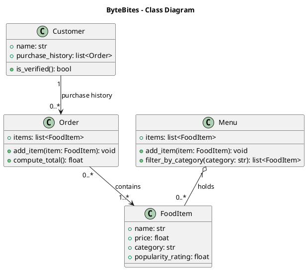

# Draft: AI-Generated Class Diagram

## Prompt Used
> I'm designing the backend for ByteBites, a food ordering app. From the client's feature request I identified four classes:
> - **Customer**: has a name and a purchase history, which is used to verify they're a real user.
> - **FoodItem**: something for sale, with a name, price, category and popularity rating.
> - **Menu**: holds all food items and can filter them by category (for example "Drinks" or "Desserts").
> - **Order**: groups the items a customer picks into one transaction and computes the total cost.
>
> Please make a simple UML class diagram for only these four classes, written in PlantUML. Use standard UML notation: `+name: type` for attributes, `+method(): returnType` for methods, and the correct UML relationship arrows (association, aggregation or composition) labeled with multiplicities. For each class, show its attributes with types and its main methods. Don't add classes that aren't in this list. After the diagram, list any assumptions you made that the requirements don't state.

## Output

### Assumptions (not stated in the feature request)
- `Customer.is_verified()` returns true when the customer has at least one past order. The spec says purchase history is used for verification but not how.
- `add_item()` on Menu and Order is implied (a collection needs a way to add items) but not explicitly requested.
- Order does not reference its Customer; the spec doesn't require it.
- Category is a plain string attribute, not a separate class.
